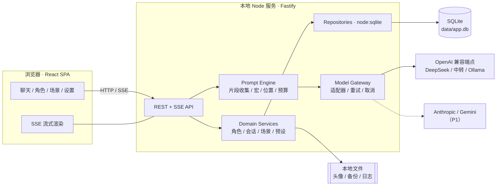
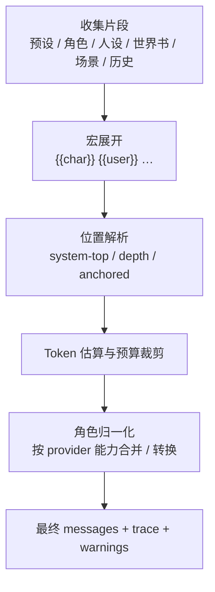
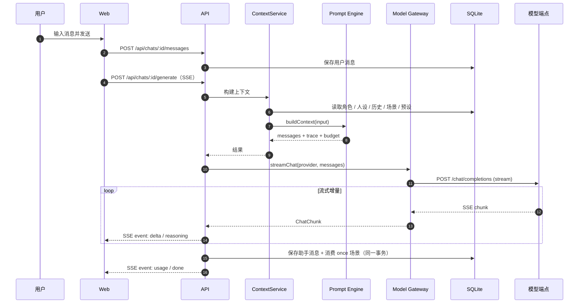

# 02 · 系统架构

> 目标：一个**本地优先、单用户、可自托管**的 Web 应用，把「模型接入」和「场景化上下文装配」做成清晰、可测试的核心，而不是散落在 UI 里的字符串拼接。

## 1. 架构目标与约束

| 目标 | 架构含义 |
| --- | --- |
| 密钥不离开本机 | 所有模型请求由本地 Node 服务代理；前端永远拿不到明文 Key |
| 换模型不改习惯 | 统一 `ProviderAdapter` 接口 + 归一化消息 / chunk；模型差异收敛在适配器 |
| 场景可解释 | 上下文装配是纯函数，输出最终消息数组 + 逐段轨迹，UI 可预览 |
| 长对话不炸 | 显式 token 预算、裁剪策略和警告，而不是把整段历史硬塞给模型 |
| 可本地部署 | SQLite + 本地文件；单进程即可跑；Docker 可选 |
| 未来能长大 | 适配器、场景位置、提示词片段均为可扩展的联合类型；先单用户，不提前做多租户 |

## 2. 总体架构



**为什么不是纯前端 + 直连模型？**

- 前端直连会把 API Key 暴露在浏览器，且受 CORS 限制，很多中转 / 本地模型不支持浏览器跨域。
- 上下文装配、token 预算、密钥管理、日志脱敏都需要可信执行环境。
- 未来做桌面壳（Tauri）或 Docker 时，本地服务层可以原样复用。

**为什么不是 Next.js 一体化？**

- 纯本地单用户，不需要 SSR / SEO / 边缘部署。
- Vite SPA + Fastify 的边界更清楚，流式代理更直接，打包进桌面壳也更简单。Next.js 作为备选保留（D2）。

## 3. 技术选型

| 层 | 建议 | 理由 | 备选 |
| --- | --- | --- | --- |
| 前端框架 | React 18 + TypeScript + Vite | 生态成熟、组件多、构建快 | Vue 3、Svelte |
| 组件库 | **Ant Design 5（antd）+ Ant Design X（`@ant-design/x`）** | 表单、弹窗、抽屉、列表、主题都是现成的；AI 对话气泡 / 输入框 / 会话列表可直接复用，减少自研 | assistant-ui、Arco Design、Mantine |
| 样式 | Ant Design Design Token + 少量 CSS Modules | 跟随 antd 主题；明暗切换用内置 algorithm，不手写两套颜色 | Tailwind（仅工具类） |
| 状态 | Zustand（本地 UI 状态）+ TanStack Query（服务端数据） | 生成流是长连接，需要细粒度控制；查询缓存处理列表 | Redux Toolkit |
| Markdown | react-markdown + remark-gfm + 自定义代码块 | 角色扮演常有 `*动作*`、引用、代码块；需关闭原始 HTML | marked + DOMPurify |
| 虚拟列表 | @tanstack/react-virtual | 万条消息不卡 | 自研分页 |
| 后端 | Node.js 22 + Fastify + TypeScript | 流式 / SSE 原生友好、插件化、性能足够 | Hono、Express |
| 校验 | Zod | 请求 / 配置 / 导入文件统一校验 | TypeBox |
| 数据库 | SQLite（WAL）+ Node 内置 `node:sqlite` | 单文件、零运维、无原生依赖、可备份；M1 用 repository 层隔离，复杂查询增多时可迁移 Drizzle | Drizzle + better-sqlite3、libSQL |
| 迁移 | drizzle-kit | 版本化 SQL 迁移 | 手写 |
| 测试 | Vitest + Playwright | 单测 + 端到端 | node:test |
| 日志 | pino | 结构化、低开销、可脱敏 | winston |
| 包管理 | pnpm workspace | 前后端共享类型 | npm workspaces |

> 版本以实际开发时的稳定版为准；Node ≥ 22。

## 4. 代码组织

```text
roleplay-chat/
├── apps/
│   ├── web/                 # React SPA
│   │   └── src/{pages,components,features,stores,lib}
│   └── server/              # Fastify API
│       └── src/{routes,plugins,services}
├── packages/
│   ├── core/                # 纯 TS，无 IO
│   │   └── src/{prompt,macros,scenes,shared}
│   ├── adapters/            # 模型适配器
│   │   └── src/{openai-compatible,anthropic,gemini}
│   └── db/                  # schema、迁移、repository
│       └── src/{schema,migrations,repositories}
├── data/                    # 运行时数据（gitignore）
└── docs/
```

**依赖方向**：`web → shared types`，`server → core / adapters / db`，`core` 不依赖 Fastify / 数据库 / 网络。这样提示词装配可以纯函数单测，未来也能被 CLI 或桌面端复用。

## 5. 模块职责

### 5.1 Prompt Engine（`packages/core`）

输入角色、人设、历史、场景、世界书、预设、模型能力，输出**最终消息数组 + 逐段轨迹 + token 预算**。

> 已实现：`buildPrompt` 支持 `system-top` / `depth` / `anchored` 场景、宏、预算裁剪与 trace；一次性场景通过 `includedSceneIds` 在成功生成后消费。`/chats/:id/context-preview` 复用同一编译过程。

```ts
interface BuildContextInput {
  character: Character;
  persona: Persona;
  history: Message[];            // 当前分支，按时间正序
  scenes: SceneDirective[];      // 当前会话所有场景（含停用，内部过滤）
  worldInfo: WorldInfoEntry[];   // P1
  preset: PromptPreset;
  provider: ProviderCapabilities;
  config: GenerationConfig;
}

interface BuildContextResult {
  messages: NormalizedMessage[]; // 可直接发给适配器
  trace: PromptTrace;            // 每段的来源、位置、token、是否裁剪
  usage: TokenBudget;            // 预算、已用、剩余
  warnings: BuildWarning[];      // 裁剪、越界、降级、未知宏
}
```

**装配流水线**：



**内置片段与默认顺序**：

| # | 片段 | 来源 | 默认位置 | P0 |
| --- | --- | --- | --- | --- |
| 1 | 主提示词 | 预设 `main` | system 顶部 | ✅ |
| 2 | 角色系统提示词 | 角色卡 `system_prompt` | system 顶部 | ✅ |
| 3 | 角色定义 | 模板 + 描述 / 性格 / 场景 | system 顶部 | ✅ |
| 4 | 用户人设 | persona | system 顶部 | ✅ |
| 5 | 世界书常驻与命中 | 世界书条目 | 按条目配置 | P1 |
| 6 | 系统常驻场景 | 场景 `system-top` | system 顶部（角色定义 / 人设之后） | ✅ |
| 7 | 历史消息 | 当前分支 | 中部 | ✅ |
| 8 | 深度 / 锚定场景 | 场景 `depth` / `anchored` | 历史中间 | ✅ |
| 9 | 末尾指令 | 预设 `post_history` | 历史之后 | ✅ |
| 10 | 预填 | prefill | 最后一条 assistant | P1 |

> 同一位置的多个片段按 `sortOrder` 升序拼装；顺序稳定是快照测试的前提。

**宏变量（P0）**：

| 宏 | 展开 |
| --- | --- |
| `{{char}}` | 角色名 |
| `{{user}}` | 人设名，未设置时用「你」 |
| `{{persona}}` | 人设描述 |
| `{{description}}` | 角色描述 |
| `{{personality}}` | 角色性格 |
| `{{scenario}}` | 角色卡场景字段 |
| `{{time}}` / `{{date}}` | 本地时间 / 日期（可选时区） |

规则：未知宏原样保留并产生 warning；宏展开在 token 估算之前；场景内容同样支持宏。

**Token 预算**：

```text
budget = model.contextWindow - config.maxTokens - 512（安全余量）
固定开销 = 主提示词 + 角色系统提示词 + 角色定义 + 人设 + 启用的常驻场景
历史预算 = budget - 固定开销 - 世界书预算（默认 25%，P1）
从最新消息向旧填充；至少保留最近 2 轮
超限时先裁最旧的历史对，再按优先级裁世界书；场景不静默丢弃
```

- 模型上下文窗口由 provider 配置指定（预置常见模型默认值，用户可改）。
- 估算器可替换：默认按字符启发式（中文约 1 字 ≈ 1 token，英文约 4 字符 ≈ 1 token），若 provider 返回 usage 则记录真实值用于校准提示。
- 如果固定开销本身超预算（例如主提示词过长），**不发送请求**，返回可操作错误：「请减少启用的场景 / 调低最大输出」。
- 裁剪结果写入 `trace`，UI 用黄色提示「已省略最早 N 条消息」。

**角色归一化**（由适配器能力驱动）：

- 支持多条 system 的 provider：原样保留。
- Anthropic 仅支持顶层 system：把 system 片段合并为一个字符串；历史中的 system 场景转为带标记的 user 消息（见 [04](04-scene-injection.md)）。
- 要求严格 user / assistant 交替的 provider：合并相邻同角色消息，或插入轻量分隔消息。
- 归一化只影响发出去的请求，不修改存储。

### 5.2 Model Gateway（`packages/adapters`）

统一入口：

```ts
interface ProviderAdapter {
  readonly kind: ProviderKind;
  readonly capabilities: ProviderCapabilities;

  listModels(config: ProviderConfig): Promise<ModelInfo[]>;
  testConnection(config: ProviderConfig): Promise<TestResult>;
  streamChat(
    config: ProviderConfig,
    request: ChatRequest,
    signal: AbortSignal,
  ): AsyncIterable<ChatChunk>;
}
```

```ts
type ChatChunk =
  | { type: 'text'; text: string }
  | { type: 'reasoning'; text: string }
  | { type: 'usage'; promptTokens: number; completionTokens: number }
  | { type: 'finish'; reason: 'stop' | 'length' | 'cancelled' | 'error' }
  | { type: 'error'; error: NormalizedError };
```

**能力标记**（决定归一化与 UI）：

```ts
interface ProviderCapabilities {
  supportsSystemInChat: boolean;   // 历史中间能否出现 system
  supportsMultipleSystem: boolean; // 能否有多条 system
  supportsPrefill: boolean;        // 能否预填 assistant
  supportsReasoning: boolean;      // 是否返回 reasoning_content
  supportsUsageInStream: boolean;  // 流里是否带 usage
  requiresAlternatingRoles: boolean;
  contextWindow?: number;
  maxOutput?: number;
}
```

**OpenAI 兼容适配器要点**：

- 请求：`POST {baseUrl}/chat/completions`，`stream: true`，`stream_options: { include_usage: true }`（不支持的端点自动降级）。
- 解析：按行缓冲 SSE，处理 `\r\n`、空行、`data: [DONE]`、`: keep-alive` 注释行；单行 JSON 解析失败不崩溃，记 warning。
- 增量：`choices[0].delta.content`；推理模型读 `delta.reasoning_content`（兼容 `reasoning`）；结束收集 `finish_reason` 与 usage。
- 错误：非 2xx 读取 JSON body，映射为统一错误码（见 03）；流中错误也归一化。
- 取消：`AbortController` 贯穿 fetch → 读流；取消后保留已生成文本。
- 超时：连接 15s，流空闲 60s（可配），总时长不设硬上限。
- 重试：网络错误 / 429 / 5xx，指数退避（1s、3s + 抖动），最多 2 次；**一旦已经输出首 token 不再重试**，避免重复内容。
- 模型列表：`GET {baseUrl}/models`；失败允许手填，不阻塞。

**服务预设**（只预填 Base URL 与常见参数，不内置任何 Key）：

| 预设 | Base URL 示例 | 备注 |
| --- | --- | --- |
| DeepSeek | `https://api.deepseek.com/v1` | 默认模型 `deepseek-chat` |
| OpenAI | `https://api.openai.com/v1` | |
| OpenRouter | `https://openrouter.ai/api/v1` | 可选 `HTTP-Referer` / `X-Title` 头 |
| Ollama | `http://127.0.0.1:11434/v1` | Key 可空 |
| LM Studio | `http://127.0.0.1:1234/v1` | Key 可空 |
| 自定义 | 用户填写 | 兼容任意 OpenAI 协议端点 |

**多模态**：P0 不支持图片输入；数据结构预留 `content` 为字符串或分段数组的联合类型，P1 再开。

### 5.3 Domain Services（`apps/server/src/services`）

- `CharacterService`：CRUD、V2 导入导出、头像文件处理。
- `ChatService`：会话、消息树、分支、重写、导出。
- `SceneService`：场景 CRUD、启停、一次性消费、锚点有效性。
- `PresetService` / `PersonaService` / `ProviderService`（含密钥加解密）。
- `ContextService`：拉取数据 → 调 Prompt Engine → 返回 trace。

服务层不直接拼 SQL，统一走 repository；所有输入先过 Zod。

### 5.4 API / SSE（`apps/server/src/routes`）

- REST 负责 CRUD 与查询；生成走 `POST /api/chats/:id/generate` 返回 `text/event-stream`。
- 每次生成有 `generationId`，服务端登记 `AbortController`，支持 `POST /api/generations/:id/cancel`。
- 同一会话同一时刻只允许一个生成，冲突返回 `409 GENERATION_IN_PROGRESS`。
- 前端用 `fetch` + `ReadableStream` 解析 SSE（原生 `EventSource` 不支持 POST 与自定义头）。

### 5.5 Web（`apps/web`）

- 路由：`/`（会话列表 / 空状态）、`/chat/:id`、`/characters`、`/characters/:id`、`/settings`。
- 聊天页三栏：左（角色 / 会话）、中（消息流 + 场景卡片 + 输入框）、右抽屉（角色 / 场景 / 预设 / 上下文预览）。
- 场景编辑器、上下文预览、provider 表单为独立 feature 模块，不塞进聊天组件。
- 组件策略：统一 Ant Design 5（`antd`）；AI 对话区优先 `@ant-design/x`（Bubble / Sender / Conversations / Prompts），覆盖不足处用 assistant-ui；不自研 Button / Input / Modal / Drawer / Toast 等基础控件。
- 主题：`ConfigProvider` + Design Token（`theme.algorithm` 切明暗），不出现第二套视觉体系。
- 领域组件：场景卡片、上下文预览、分支切换没有完全现成的库，用 antd 的 Card / Tag / Drawer / Tree / Segmented / Popconfirm 组合；只有消息流虚拟化与场景装配可视化需要自研。
- 简单 / 高级模式：同一套数据与 API，简单模式只渲染三个场景意图和内容，高级模式才展开深度、身份、排序、token；不维护两套页面。
- 对话框：默认「分段输入」，对话为主，场景 / 动作 / 神态用 chip 按需展开（不默认堆四个框）；`composeUserMessage`（core）把非空字段合成一条 user 消息，只有对话时保持自然文本；底部有组合预览与「自由输入」切换。
- AI 推荐：工具栏「帮我想想」打开 Drawer，调用 `POST /api/chats/:id/suggestions`；`buildSuggestionPrompt`（core）使用独立的编剧助手提示词，`parseSuggestions` 解析 JSON；建议只返回、不落库、不自动发送。
- 流式渲染：增量文本进入 store，Markdown 解析节流（约 60ms / 帧）；用户上翻时暂停自动滚动。

## 6. 关键流程

### 6.1 一次生成



要点：

- **先保存用户消息再生成**，生成失败也不丢输入。
- 助手消息在开始时创建（状态 `streaming`），增量可周期落盘（每 500ms 或每 200 字符），防崩溃丢失；结束后更新为 `complete` / `cancelled` / `error`。
- 客户端断开：默认中止上游请求（省 token），保留部分内容；这是 P0 的固定行为。
- 生成完成后才消费 `once` 场景；失败 / 取消不消费，方便重试。

### 6.2 重写与分支

- 消息是树：`parent_id` 指向父消息，同一父节点下的多条助手消息互为候选。
- 「重写」= 以同一父节点再生成一条兄弟消息，并把它设为当前叶。
- 当前分支 = 从 `chat.active_leaf_id` 沿 `parent_id` 回溯到根。
- 切换分支只改 `active_leaf_id`，历史数据不复制、不移动，天然支持任意深度回溯。
- 场景是会话级对象，不随分支复制；锚点消息不在当前分支时标记为「当前分支不可用」（P0 直接不注入并提示，P2 再做分支级场景）。

### 6.3 流式协议

```text
event: meta
data: {"generationId":"g_01","messageId":"m_42","model":"deepseek-chat"}

event: delta
data: {"text":"雨"}

event: reasoning
data: {"text":"（思考）……"}

event: usage
data: {"promptTokens":3120,"completionTokens":87}

event: done
data: {"finishReason":"stop"}

event: error
data: {"code":"RATE_LIMITED","message":"上游限流，请稍后重试"}
```

- `meta` 必发；`usage` 视 provider 能力；`done` 与 `error` 互斥且最后发送。
- 每个事件是单行 JSON（`data:` 后跟 JSON），前端增量解析，避免整包等待。
- 错误码表见 [03](03-data-model-and-api.md)。

## 7. 数据与存储

详细表结构见 [03](03-data-model-and-api.md)。

- SQLite WAL 模式，`busy_timeout=5000`；单写者（Node 进程内串行）。
- 数据目录：`DATA_DIR`（默认 `./data`），包含 `app.db`、`avatars/`、`backups/`、`logs/`。
- 头像文件名为 UUID + 扩展名，避免路径穿越与重名。
- 每日自动备份（SQLite Online Backup API），保留 7 份；手动导出 JSON 为另一层保障。
- 迁移：drizzle-kit 生成，启动时自动执行；迁移前自动备份。

## 8. 安全与隐私

| 面 | 措施 |
| --- | --- |
| 网络暴露 | 默认 `127.0.0.1`；监听 `0.0.0.0` 必须设置 `ACCESS_TOKEN`，未设置则拒绝启动并提示 |
| API Key | AES-256-GCM 加密落盘；主密钥来自 `MASTER_KEY` 环境变量或 `data/.master.key`（0600，首次生成）；只在网关内存解密 |
| 密钥回传 | API 响应只返回掩码（如 `sk-…a1b2`）；前端无任何明文密钥 |
| 日志 | pino redact：`authorization`、`apiKey`、`token`；默认不记录提示词正文，调试模式需显式开启 |
| XSS | 模型输出按不可信 Markdown 渲染，禁用原始 HTML；链接仅允许 http/https；图片仅本地 / 可信协议 |
| CSRF | 仅接受 `application/json`；校验 `Origin`；局域网模式校验 Bearer Token |
| SSRF | 用户填写的 Base URL 仅允许 http/https；这是本地单用户应用，允许 localhost / 内网（Ollama 需要），文档中说明风险 |
| 数据导出 | 默认不含密钥；含角色、消息、场景、参数 |
| 依赖 | 锁定版本；CI 跑 `pnpm audit`（告警不阻塞） |

## 9. 部署与运行

**开发**

```bash
pnpm install
pnpm dev          # server :8787 + web :5173（/api 代理）
```

**生产（单进程）**

```bash
pnpm build
pnpm start        # Fastify 同时托管 apps/web/dist 与 /api，默认 :8787
```

**Docker（P1）**

```bash
docker run -d --name roleplay-chat \
  -p 127.0.0.1:8787:8787 \
  -v roleplay-data:/data \
  roleplay-chat:latest
```

环境变量：

| 变量 | 默认 | 说明 |
| --- | --- | --- |
| `PORT` | `8787` | 服务端口 |
| `HOST` | `127.0.0.1` | 监听地址 |
| `DATA_DIR` | `./data` | 数据目录 |
| `MASTER_KEY` | 自动生成 | 密钥加密主密钥 |
| `ACCESS_TOKEN` | 空 | 非本机监听时的访问令牌 |
| `LOG_LEVEL` | `info` | 日志级别 |
| `DEBUG_PROMPTS` | `false` | 是否记录提示词正文（默认关闭） |

## 10. 性能与容量

- 消息分页：按 `created_at` / `id` 反向游标，每页 50 条；前端虚拟列表。
- 上下文装配只处理当前分支的尾部窗口，不加载全部历史；1 万条消息的会话装配耗时应 < 50ms。
- SQLite 索引：`messages(chat_id, parent_id)`、`messages(chat_id, created_at)`、`scenes(chat_id)`、`chats(character_id)`。
- SSE 增量在服务端按 20–50ms 合并后再发，减少前端重渲染；Markdown 渲染节流。
- 首 token 延迟主要由模型决定；服务端不因写库阻塞流（异步写 + 结束落盘）。

## 11. 失败处理

| 场景 | 行为 |
| --- | --- |
| provider 401 / 403 | 提示检查 Key；不重试 |
| 429 / 5xx | 退避重试 2 次；仍失败则提示限流 / 服务异常 |
| 上下文超限（400） | 展示预算详情；提供「减少历史 / 降低输出 / 关闭场景」建议；不自动无限重试 |
| 流中断 | 保留已生成内容并标记「连接中断」；提供「继续生成」（P1）或「重写」 |
| 取消 | 保存已生成部分，状态 `cancelled`；不消费一次性场景 |
| 数据库异常 | 请求失败但已有数据不丢；启动时迁移失败则拒绝启动并提示备份路径 |
| 导入非法文件 | 返回字段级错误，不写库 |

## 12. 测试策略

| 层 | 内容 |
| --- | --- |
| 单元 | 宏展开、位置解析、深度边界、token 裁剪、角色归一化、错误映射 |
| 快照 | 固定角色 / 历史 / 场景 / 预设 → 期望的最终 `messages` 数组；覆盖 3 种场景位置 × 2 种生命周期 × 裁剪 |
| 适配器 | 用本地 mock SSE 服务器回放 fixture：正常流、usage、`reasoning_content`、断流、429、超时、`[DONE]` 缺失 |
| 集成 | Fastify `inject` + 临时 SQLite：provider / 角色 / 会话 / 场景 CRUD、生成落库、取消 |
| 端到端 | Playwright：配置 mock provider → 导入角色卡 → 流式聊天 → 插入场景 → 预览 → 重写 → 导出 |
| 回归 | 金样本：同一输入在改动前后装配结果 diff 必须可解释 |

CI（GitHub Actions）：`typecheck`、`lint`、`test`、`build`；E2E 可在本地或 nightly 跑。

## 13. 可观测性与调试

- 请求 ID 贯穿 API → 上下文装配 → 适配器日志。
- 调试抽屉（设置里开启）：最近一次请求的最终消息数组、provider 参数、耗时、usage；Key 脱敏，正文默认折叠。
- 每次生成记录：模型、耗时、首 token 时间、token 用量、错误码（`generation_logs` 可选表，P1）。
- 不在日志中记录完整角色卡 / 场景正文，除非用户显式开启 `DEBUG_PROMPTS`。

## 14. 扩展点

| 扩展 | 方式 |
| --- | --- |
| 新模型协议 | 实现 `ProviderAdapter` 并注册；不改上层 |
| 新场景位置 | `ScenePlacement` 联合类型加分支 + 装配器处理 + UI 表单 |
| 新提示词片段 | 预设里增加片段类型；引擎按位置插槽处理 |
| 世界书触发策略 | 独立 `WorldInfoResolver` 接口（P1） |
| 工具调用 / 联网 | 预留 adapter 的 tool chunk；P2 再设计，不在 MVP 引入 |
| 桌面端 | 用 Tauri 包一层，复用 server 与 web 构建产物 |

## 15. 关键风险

| 风险 | 影响 | 应对 |
| --- | --- | --- |
| 不同模型对 system / 历史中 system 的处理差异大 | 场景不生效或报错 | 能力标记 + 适配器归一化 + 预览里显示实际角色 |
| token 估算不准 | 超限或被过早裁剪 | 保守安全余量；记录真实 usage；允许手动调上下文窗口 |
| 模型不遵循场景指令 | 体验不稳定 | 标准包装模板 + 默认靠近末尾 + 身份可选 + 文档说明这是模型能力问题 |
| 长对话性能 | 卡顿 | 虚拟列表 + 分页 + 装配只取窗口 |
| 范围膨胀 | 交付延期 | P0 严格按 01 文档，群聊 / 多模态 / 语音后置 |
| 本地数据丢失 | 用户资产损失 | 自动备份 + 导出 + 迁移前备份 + 明确数据目录 |
| 组件库定制受限 / 升级回归 | 视觉与交互受 antd 约束 | 用 Design Token 定制；领域组件基于 antd 原语组合；锁定版本并做关键页面回归测试 |