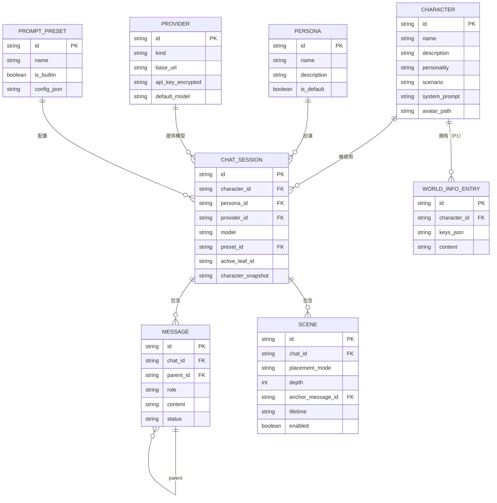

# 03 · 数据模型与 API

> 本文是实现的契约：数据库表、REST / SSE 接口、模型适配器接口、导入导出格式。字段命名统一 `camelCase`（API / TS）与 `snake_case`（SQLite），由 `packages/db` 的 repository 层映射（M1 使用 Node 内置 `node:sqlite`，表结构独立于驱动）。

## 1. 通用约定

| 项 | 约定 |
| --- | --- |
| ID | UUIDv7 字符串（可按时间排序），服务端生成 |
| 时间 | ISO 8601 UTC 字符串（`2026-11-10T08:00:00.000Z`） |
| 布尔 | SQLite 存 `0 / 1`，API 用 `true / false` |
| JSON | SQLite 存 TEXT，API 用对象 / 数组；读取时校验并给默认值 |
| 删除 | 会话 / 消息级联删除；角色删除不级联（会话保存角色快照） |
| 分页 | `?limit=50&before=<messageId>`，返回 `{ items, nextCursor }` |
| 错误 | `{ "error": { "code": "INVALID_INPUT", "message": "…", "details": {} } }` |
| 认证 | 默认本机无认证；非 `127.0.0.1` 监听时要求 `Authorization: Bearer <ACCESS_TOKEN>` |
| 版本 | 导出格式、数据库迁移均带版本号 |

## 2. 数据模型

### 2.1 ER 概览



### 2.2 表结构

#### `characters`

| 列 | 类型 | 说明 |
| --- | --- | --- |
| `id` | TEXT PK | |
| `name` | TEXT NOT NULL | 角色名 |
| `description` | TEXT | 外貌 / 背景描述 |
| `personality` | TEXT | 性格摘要 |
| `scenario` | TEXT | 角色卡原始场景字段（与「场景指令」不是同一概念） |
| `first_message` | TEXT | 默认开场白 |
| `alternate_greetings` | TEXT (JSON) | 备选开场白数组 |
| `example_dialogue` | TEXT | 示例对话（可含 `{{char}}` / `{{user}}`） |
| `system_prompt` | TEXT | 角色级系统提示词 |
| `post_history_instructions` | TEXT | 角色级末尾指令（优先级低于预设） |
| `creator_notes` | TEXT | 原作者备注，导入保留 |
| `tags` | TEXT (JSON) | 标签数组 |
| `avatar_path` | TEXT | 相对 `DATA_DIR/avatars` 的路径 |
| `spec` | TEXT | `v2` / `custom` |
| `raw_extensions` | TEXT (JSON) | 角色卡未知字段原样保留，导出时带回 |
| `created_at` / `updated_at` | TEXT | |

#### `personas`

| 列 | 类型 | 说明 |
| --- | --- | --- |
| `id` | TEXT PK | |
| `name` | TEXT NOT NULL | 用户在此人设下的名字 |
| `description` | TEXT | 身份、外貌、与角色关系 |
| `avatar_path` | TEXT | |
| `is_default` | INTEGER | 全局默认人设至多一个 |
| `created_at` / `updated_at` | TEXT | |

#### `providers`

| 列 | 类型 | 说明 |
| --- | --- | --- |
| `id` | TEXT PK | |
| `name` | TEXT NOT NULL | 展示名 |
| `kind` | TEXT | `openai-compatible` / `anthropic` / `gemini` |
| `base_url` | TEXT | 不带结尾 `/` |
| `api_key_encrypted` | TEXT | 版本化信封：`v1:<iv>:<tag>:<cipher>`（base64） |
| `extra_headers` | TEXT (JSON) | 自定义请求头（如 OpenRouter 的 Referer） |
| `default_model` | TEXT | |
| `context_window` | INTEGER | 用户可改；预置默认值 |
| `capabilities` | TEXT (JSON) | 能力覆盖，默认由 `kind` 决定 |
| `models_cache` | TEXT (JSON) | `/models` 拉取结果缓存 |
| `created_at` / `updated_at` | TEXT | |

#### `prompt_presets`

| 列 | 类型 | 说明 |
| --- | --- | --- |
| `id` | TEXT PK | |
| `name` | TEXT NOT NULL | |
| `is_builtin` | INTEGER | 内置预设不可删除，可「另存为」 |
| `config` | TEXT (JSON) | 片段数组与默认参数，见 §6 |
| `created_at` / `updated_at` | TEXT | |

#### `chat_sessions`

| 列 | 类型 | 说明 |
| --- | --- | --- |
| `id` | TEXT PK | |
| `character_id` | TEXT NULL | 角色被删后置空 |
| `character_snapshot` | TEXT (JSON) NOT NULL | 创建时的角色完整快照，保证历史不坏 |
| `persona_id` | TEXT NULL | |
| `persona_snapshot` | TEXT (JSON) | |
| `title` | TEXT | 默认「角色名 · 日期」，可改 |
| `provider_id` | TEXT NULL | provider 被删后置空并提示重选 |
| `model` | TEXT | |
| `params` | TEXT (JSON) | temperature / topP / maxTokens / stop 等，未设置走默认 |
| `preset_id` | TEXT NULL | |
| `active_leaf_id` | TEXT NULL | 当前分支叶节点 |
| `archived` | INTEGER | 归档 |
| `created_at` / `updated_at` / `last_message_at` | TEXT | |

#### `messages`

| 列 | 类型 | 说明 |
| --- | --- | --- |
| `id` | TEXT PK | |
| `chat_id` | TEXT NOT NULL FK | 级联删除 |
| `parent_id` | TEXT NULL | 树结构；根消息为空 |
| `role` | TEXT | `user` / `assistant` / `system` |
| `content` | TEXT | 正文纯文本（Markdown） |
| `reasoning` | TEXT | 推理内容（可选） |
| `status` | TEXT | `streaming` / `complete` / `cancelled` / `error` |
| `token_count` | INTEGER | 估算或 provider 返回值 |
| `model` | TEXT | 生成该条消息的模型 |
| `usage` | TEXT (JSON) | `{ promptTokens, completionTokens }` |
| `finish_reason` | TEXT | `stop` / `length` / `cancelled` / `error` |
| `created_at` | TEXT | |

索引：`(chat_id, parent_id)`、`(chat_id, created_at)`、`(parent_id)`。

> 分支不需要单独的表：`parent_id` 构成树，`active_leaf_id` 决定当前路径。重写 = 同一 `parent_id` 下新增兄弟节点。

> 实现状态：`scenes` 表、场景 CRUD 与上下文预览已接入；场景模板 / 时间线卡片 / 复制接口仍在后续里程碑。

#### `scenes`

| 列 | 类型 | 说明 |
| --- | --- | --- |
| `id` | TEXT PK | |
| `chat_id` | TEXT NOT NULL FK | 级联删除 |
| `title` | TEXT | 卡片标题，可空（自动截取） |
| `content` | TEXT NOT NULL | 场景正文，支持宏 |
| `role` | TEXT | `system` / `user` / `assistant` |
| `placement_mode` | TEXT | `system-top` / `depth` / `anchored` |
| `depth` | INTEGER | 仅 `depth` 模式使用，≥ 0 |
| `anchor_message_id` | TEXT NULL | 仅 `anchored` 模式使用 |
| `sort_order` | INTEGER | 同一插入点的顺序 |
| `lifetime` | TEXT | `persistent` / `once` |
| `enabled` | INTEGER | |
| `consumed_at` | TEXT NULL | `once` 场景被消费的时间 |
| `created_at` / `updated_at` | TEXT | |

索引：`(chat_id, enabled)`、`(anchor_message_id)`。

#### `world_info_entries`（P1）

| 列 | 类型 | 说明 |
| --- | --- | --- |
| `id` | TEXT PK | |
| `character_id` | TEXT NULL | 为空表示全局 |
| `name` | TEXT NOT NULL | |
| `keys` | TEXT (JSON) | 主关键词数组 |
| `secondary_keys` | TEXT (JSON) | 次要关键词 |
| `selective` | INTEGER | 是否需要次要关键词也命中 |
| `constant` | INTEGER | 常驻（不依赖关键词） |
| `content` | TEXT | |
| `position` | TEXT | `system-top` / `depth` / `chat-end` |
| `depth` | INTEGER | `depth` 模式使用 |
| `order` | INTEGER | 同位置排序 |
| `probability` | INTEGER | 0–100，命中后按概率注入 |
| `scan_depth` | INTEGER | 扫描最近多少条消息，默认 4 |
| `enabled` | INTEGER | |

#### `settings`

| 列 | 类型 | 说明 |
| --- | --- | --- |
| `key` | TEXT PK | 如 `ui.theme`、`ui.mode`、`onboarding.completed` |
| `value` | TEXT (JSON) | |

#### `generation_logs`（P1）

生成诊断：`id`、`chat_id`、`message_id`、`provider_id`、`model`、`prompt_tokens`、`completion_tokens`、`ttft_ms`、`total_ms`、`error_code`、`created_at`。

### 2.3 文件布局

```text
DATA_DIR/
├── app.db
├── .master.key          # 0600，首次启动生成；也可用 MASTER_KEY 覆盖
├── avatars/
│   └── <uuid>.png
├── backups/
│   └── app-2026-11-10T08-00-00.db
└── logs/
    └── app.log
```

## 3. API 一览

基础路径 `/api`，除导入外均为 JSON。

### 3.1 角色与人设

| 方法 | 路径 | 说明 |
| --- | --- | --- |
| GET | `/characters?q=&tag=` | 列表（含最近使用时间） |
| POST | `/characters` | 创建 |
| GET | `/characters/:id` | 详情 |
| PATCH | `/characters/:id` | 更新 |
| DELETE | `/characters/:id` | 删除（不删会话） |
| POST | `/characters/import` | `multipart/form-data`：`file`（png / json）；当前 MVP 由 Web 端解析后调用 `POST /characters`，服务端 multipart 接口待补 |
| GET | `/characters/:id/export?format=json` | 导出角色卡；`format=png` 为 P1 |
| GET | `/personas` | 人设列表 |
| POST | `/personas` | 创建人设 |
| PATCH | `/personas/:id` | 更新人设 |
| DELETE | `/personas/:id` | 删除人设 |
| POST | `/personas/:id/avatar` | 人设头像上传（multipart） |
| POST | `/characters/:id/avatar` | 角色头像上传（multipart） |
| DELETE | `/characters/:id/avatar` | 删除角色头像 |
| DELETE | `/personas/:id/avatar` | 删除人设头像 |

### 3.2 模型接入

| 方法 | 路径 | 说明 |
| --- | --- | --- |
| GET | `/providers` | 列表（Key 掩码） |
| POST | `/providers` | 创建 |
| GET | `/providers/:id` | 详情（Key 掩码） |
| PATCH | `/providers/:id` | 更新（不传 Key 表示不变） |
| DELETE | `/providers/:id` | 删除 |
| POST | `/providers/:id/test` | 测试连接，不落库 |
| GET | `/providers/:id/models` | 拉取模型列表（可带 `?refresh=1`） |
| POST | `/providers/test` | 用临时配置测试（创建前试用） |
| GET | `/presets` | 提示词预设列表 |
| POST | `/presets` | 创建预设 |
| PATCH | `/presets/:id` | 更新预设 |
| DELETE | `/presets/:id` | 删除预设（内置不可删） |

### 3.3 会话与消息

| 方法 | 路径 | 说明 |
| --- | --- | --- |
| GET | `/chats?characterId=&archived=` | 会话列表 |
| POST | `/chats` | 新建会话（角色、人设、provider、开场白索引） |
| GET | `/chats/:id` | 会话详情 |
| PATCH | `/chats/:id` | 重命名 / 归档 / 切换 provider / 参数 |
| DELETE | `/chats/:id` | 删除 |
| GET | `/chats/:id/messages?limit=&before=` | 当前分支分页消息 |
| POST | `/chats/:id/messages` | 追加用户消息 |
| PATCH | `/messages/:id` | 编辑内容（不改变树结构） |
| DELETE | `/messages/:id` | 删除该消息及其子树 |
| POST | `/chats/:id/switch-branch` | `{ leafId }` 切换当前分支 |
| GET | `/chats/:id/tree` | 分支树摘要（用于分支选择器） |
| GET | `/chats/:id/export` | 导出 JSON |
| POST | `/chats/import` | 导入 JSON 为新会话 |

### 3.4 场景

| 方法 | 路径 | 说明 |
| --- | --- | --- |
| GET | `/chats/:id/scenes?leafId=` | 场景列表（含停用；可带当前叶节点以计算 `placementValid`） |
| POST | `/chats/:id/scenes` | 新建场景 |
| PATCH | `/scenes/:id` | 编辑 / 启停 / 改位置 |
| DELETE | `/scenes/:id` | 删除 |
| POST | `/scenes/:id/duplicate` | 复制 |
| GET | `/chats/:id/scene-templates` | 内置 / 自定义模板（P1） |

> 简单模式不直接暴露 `placement`：前端把「当前场景 / 插入剧情 / 这一轮要求」映射为 `system-top` / `anchored` / `depth:0`，API 契约保持不变。映射见 [04](04-scene-injection.md) 与 §10 的 `DEFAULTS.scene.intents`。

### 3.5 生成与上下文

| 方法 | 路径 | 说明 |
| --- | --- | --- |
| POST | `/chats/:id/generate` | 生成，返回 `text/event-stream` |
| POST | `/generations/:id/cancel` | 取消生成 |
| POST | `/chats/:id/suggestions` | AI 推荐下一条（不落库、不自动发送） |
| GET | `/chats/:id/context-preview?leafId=` | 预览最终上下文、预算、trace |
| GET | `/health` | 健康检查 |

### 3.6 设置

| 方法 | 路径 | 说明 |
| --- | --- | --- |
| GET | `/settings` | 全部设置（含默认值） |
| PUT | `/settings` | 批量更新 |
| POST | `/backup` | 立即备份（P1） |
| GET | `/backups` | 备份列表（P1） |

## 4. 关键请求 / 响应

### 4.1 创建 provider

```http
POST /api/providers
Content-Type: application/json

{
  "name": "DeepSeek",
  "kind": "openai-compatible",
  "baseUrl": "https://api.deepseek.com/v1",
  "apiKey": "sk-xxxxxxxx",
  "defaultModel": "deepseek-chat",
  "contextWindow": 65536,
  "extraHeaders": {}
}
```

```json
{
  "id": "0192f0c4-...",
  "name": "DeepSeek",
  "kind": "openai-compatible",
  "baseUrl": "https://api.deepseek.com/v1",
  "apiKeyMasked": "sk-…a1b2",
  "defaultModel": "deepseek-chat",
  "contextWindow": 65536,
  "capabilities": {
    "supportsSystemInChat": true,
    "supportsMultipleSystem": true,
    "supportsPrefill": true,
    "supportsReasoning": false,
    "supportsUsageInStream": true,
    "requiresAlternatingRoles": false
  }
}
```

### 4.2 追加消息

```http
POST /api/chats/:id/messages

{ "content": "她抬起头，看向门口。", "parentId": "m_41" }
```

返回消息对象；`parentId` 省略时挂到当前叶节点，服务端同时把 `chat.active_leaf_id` 更新为该消息。

### 4.3 生成（SSE）

```http
POST /api/chats/:id/generate
Content-Type: application/json

{
  "parentMessageId": "m_42",
  "overrides": { "temperature": 0.9 }
}
```

响应头：`Content-Type: text/event-stream; charset=utf-8`、`Cache-Control: no-cache`、`X-Accel-Buffering: no`。

事件序列见 [02 §6.3](02-architecture.md#63-流式协议)。补充：

- 生成开始即创建 `message`（`status=streaming`），`meta` 事件返回 `messageId`。
- 客户端断开 → 服务端 abort 上游，消息落为 `cancelled`。
- `overrides` 只允许本次请求覆盖生成参数，不写库。

### 4.4 上下文预览

```http
GET /api/chats/:id/context-preview?leafId=m_42
```

`leafId` 省略时使用会话当前的 `active_leaf_id`。

```json
{
  "model": "deepseek-chat",
  "budget": {
    "contextWindow": 65536,
    "reservedOutput": 2048,
    "safetyMargin": 512,
    "used": 3120,
    "remaining": 59856
  },
  "messages": [
    { "role": "system", "content": "……", "source": "preset.main" },
    { "role": "system", "content": "【场景说明｜导演指令】……", "source": "scene:sc_1" },
    { "role": "user", "content": "……", "source": "message:m_41" }
  ],
  "trace": [
    {
      "source": "scene:sc_1",
      "title": "雨夜停电",
      "role": "system",
      "position": "anchored:m_41",
      "tokens": 42,
      "included": true
    },
    {
      "source": "message:m_03",
      "role": "assistant",
      "position": "history",
      "tokens": 96,
      "included": false,
      "reason": "超出预算，已裁剪"
    }
  ],
  "warnings": [
    { "code": "TRIMMED_HISTORY", "message": "已省略最早 6 条消息", "count": 6 }
  ]
}
```

> `preview` 与真正生成共用同一个 `buildContext`，保证「看到什么就发什么」。

### 4.5 创建场景

```http
POST /api/chats/:id/scenes

{
  "title": "雨夜停电",
  "content": "深夜，暴雨。咖啡馆突然断电，只有应急灯亮着。角色的手机在口袋里震动。",
  "role": "system",
  "placement": { "mode": "anchored", "messageId": "m_01" },
  "lifetime": "persistent",
  "enabled": true
}
```

```json
{
  "id": "sc_01",
  "chatId": "c_01",
  "title": "雨夜停电",
  "role": "system",
  "placement": { "mode": "anchored", "messageId": "m_01" },
  "lifetime": "persistent",
  "enabled": true,
  "sortOrder": 0,
  "placementValid": true,
  "createdAt": "2026-11-10T08:00:00.000Z",
  "updatedAt": "2026-11-10T08:00:00.000Z"
}
```

### 4.6 取消生成

```http
POST /api/generations/g_01/cancel
```

返回 `204`；对应的 SSE 流以 `done { finishReason: "cancelled" }` 结束。

## 5. 错误码

| HTTP | `code` | 场景 | 前端提示 |
| --- | --- | --- | --- |
| 400 | `INVALID_INPUT` | 参数 / 导入文件不合法 | 字段级错误 |
| 400 | `CONTEXT_LENGTH_EXCEEDED` | 固定开销超预算 | 建议减少场景 / 历史 / 输出 |
| 401 | `UNAUTHORIZED` | 局域网令牌错误 | 重新输入访问令牌 |
| 404 | `NOT_FOUND` | 资源不存在 | 返回列表 |
| 409 | `GENERATION_IN_PROGRESS` | 同一会话并发生成 | 先停止当前生成 |
| 409 | `ANCHOR_INVALID` | 场景锚点不存在 / 不属于该会话 | 重新选择插入位置 |
| 422 | `PROVIDER_CONFIG_INVALID` | Base URL / 模型名不合法 | 检查配置 |
| 429 | `PROVIDER_RATE_LIMITED` | 上游限流 | 稍后重试 / 换 Key |
| 502 | `PROVIDER_AUTH` | 上游 401/403 | 检查 Key / 权限 |
| 502 | `PROVIDER_UNAVAILABLE` | 网络 / 5xx / 超时 | 检查端点与网络 |
| 502 | `PROVIDER_RESPONSE_INVALID` | 返回结构无法解析 | 查看调试抽屉 |
| 502 | `SUGGESTION_INVALID` | 模型没有返回可解析的建议 | 提示重试 |
| 504 | `SUGGESTION_TIMEOUT` | AI 推荐超时 | 提示重试 |
| 500 | `INTERNAL` | 未预期异常 | 显示 requestId |

## 6. 提示词预设 JSON

```ts
interface PromptPresetConfig {
  segments: PromptSegmentConfig[];
  defaults?: Partial<GenerationConfig>;
}

interface PromptSegmentConfig {
  id: string;
  kind: 'main' | 'character-system' | 'character-definition'
      | 'persona' | 'world-info' | 'scene' | 'post-history' | 'custom';
  enabled: boolean;
  role: 'system' | 'user' | 'assistant';
  position: 'system-top' | 'chat-end';
  order: number;
  content?: string;   // kind=custom 或覆盖模板时使用
}
```

内置默认预设（示意）：

```json
{
  "segments": [
    { "id": "main", "kind": "main", "enabled": true, "role": "system", "position": "system-top", "order": 10 },
    { "id": "char-system", "kind": "character-system", "enabled": true, "role": "system", "position": "system-top", "order": 20 },
    { "id": "char-def", "kind": "character-definition", "enabled": true, "role": "system", "position": "system-top", "order": 30 },
    { "id": "persona", "kind": "persona", "enabled": true, "role": "system", "position": "system-top", "order": 40 },
    { "id": "scene-system", "kind": "scene", "enabled": true, "role": "system", "position": "system-top", "order": 50 },
    { "id": "post", "kind": "post-history", "enabled": true, "role": "system", "position": "chat-end", "order": 90 }
  ]
}
```

> 注意：预设片段里的 `chat-end` 表示「历史之后」，是**提示词片段**的位置；场景没有 `chat-end` 位置，需要贴近生成末尾时用 `depth: 0`（见 [04](04-scene-injection.md)）。

场景的 `depth` / `anchored` 不写在预设里，由场景自身的 `placement` 决定。

## 7. 模型适配器接口

```ts
type ProviderKind = 'openai-compatible' | 'anthropic' | 'gemini';

interface ModelInfo {
  id: string;
  name?: string;
  contextWindow?: number;
  maxOutput?: number;
}

interface ChatRequest {
  model: string;
  messages: NormalizedMessage[];
  temperature?: number;
  topP?: number;
  maxTokens?: number;
  presencePenalty?: number;
  frequencyPenalty?: number;
  stop?: string[];
  seed?: number;
  // 高级：透传额外 body，仅在「高级」里暴露
  extraBody?: Record<string, unknown>;
}

interface NormalizedMessage {
  role: 'system' | 'user' | 'assistant';
  content: string;
}

interface TestResult {
  ok: boolean;
  latencyMs?: number;
  models?: ModelInfo[];
  error?: NormalizedError;
}

interface NormalizedError {
  code:
    | 'PROVIDER_AUTH'
    | 'PROVIDER_RATE_LIMITED'
    | 'PROVIDER_UNAVAILABLE'
    | 'PROVIDER_RESPONSE_INVALID'
    | 'CONTEXT_LENGTH_EXCEEDED'
    | 'CANCELLED'
    | 'UNKNOWN';
  status?: number;
  message: string;
  retryable: boolean;
}
```

**OpenAI 兼容参数映射**

| 统一字段 | OpenAI 字段 |
| --- | --- |
| `messages` | `messages` |
| `model` | `model` |
| `temperature` | `temperature` |
| `topP` | `top_p` |
| `maxTokens` | `max_tokens` |
| `presencePenalty` | `presence_penalty` |
| `frequencyPenalty` | `frequency_penalty` |
| `stop` | `stop` |
| `seed` | `seed` |
| `stream` | `true` |
| `extraBody` | 平铺合并（用户自担风险） |

**能力默认值**

| kind | system in chat | 多条 system | prefill | reasoning | usage in stream |
| --- | --- | --- | --- | --- | --- |
| `openai-compatible` | ✅（可在 provider 上覆盖） | ✅ | ✅ | 视模型 | ✅（不支持时自动降级） |
| `anthropic` | ❌ | ❌（合并为顶层 system） | ✅ | ✅（thinking，P1） | ✅ |
| `gemini` | ✅ | ✅ | ❌ | 视模型 | ✅ |

> 能力是提示，不是保证；真实兼容性由适配器归一化兜底，并在预览中展示实际发送的角色。

## 8. 导入 / 导出

### 8.1 会话导出

```json
{
  "format": "roleplay-chat/export",
  "version": 1,
  "exportedAt": "2026-11-10T08:00:00.000Z",
  "character": { "name": "……", "description": "……", "avatar": "data:image/png;base64,…" },
  "persona": { "name": "……", "description": "……" },
  "chat": {
    "title": "……",
    "model": "deepseek-chat",
    "params": { "temperature": 0.8, "maxTokens": 1024 },
    "preset": { "name": "默认", "config": {} }
  },
  "messages": [
    { "id": "m_01", "parentId": null, "role": "assistant", "content": "……", "createdAt": "…" }
  ],
  "scenes": [
    { "title": "雨夜停电", "content": "……", "role": "system", "placement": { "mode": "anchored", "messageId": "m_01" }, "lifetime": "persistent", "enabled": true }
  ]
}
```

- 头像以 base64 内嵌，保证单文件可迁移。
- **不包含** provider 密钥；导入时若原 provider 不存在，提示选择新 provider。
- 导入时重建消息树，保留 `parentId`；未知字段忽略并记录 warning。
- 版本升级通过 `version` + 迁移函数处理。

### 8.2 SillyTavern 角色卡 V2

| V2 字段 | 本项目字段 |
| --- | --- |
| `name` | `name` |
| `description` | `description` |
| `personality` | `personality` |
| `scenario` | `scenario` |
| `first_mes` | `first_message` |
| `alternate_greetings` | `alternate_greetings` |
| `mes_example` | `example_dialogue` |
| `system_prompt` | `system_prompt` |
| `post_history_instructions` | `post_history_instructions` |
| `creator_notes` | `creator_notes` |
| `tags` | `tags` |
| `character_book` | 世界书（P1；P0 先存 `raw_extensions`） |
| 未知字段 | `raw_extensions` |

PNG 导入：读取 `tEXt` / `iTXt` 中 key 为 `chara` 的 base64 JSON；支持 `ccv3`（V3）在 P1 解析，P0 至少不报错并提示仅导入 V2 兼容字段。

## 9. 并发与一致性

- 每个聊天最多一个进行中的生成（内存 Map `chatId → generation`）。
- 消息状态机：`streaming → complete | cancelled | error`；不允许从终态回到 `streaming`。
- 删除消息时级联删除其子树；若被删节点是 `active_leaf_id`，自动回退到父节点。
- 场景锚点消息被删除：场景保留，`anchor_message_id` 置空并标记 `orphaned`（API 返回 `placementValid: false`），UI 提示重新锚定。
- 生成过程中编辑历史 / 场景：只影响**下一次**请求；当前请求使用开始时的快照。
- 数据库写入串行化（单进程 + `node:sqlite` 同步 API），避免并发写锁冲突。

## 10. 配置默认值

```ts
const DEFAULTS = {
  ui: {
    mode: 'simple',            // simple | advanced
    theme: 'system',           // system | light | dark
  },
  onboarding: {
    completed: false,
  },
  generation: {
    temperature: 0.8,
    topP: 0.95,
    maxTokens: 1024,
    presencePenalty: 0,
    frequencyPenalty: 0,
  },
  context: {
    safetyMargin: 512,
    minRecentTurns: 2,
    defaultWindow: 8192,       // provider 未声明上下文窗口时的兜底
    worldInfoBudgetRatio: 0.25, // P1
  },
  scene: {
    defaultRole: 'system',
    defaultLifetime: 'persistent',
    defaultPlacement: { mode: 'depth', depth: 0 },
    intents: {
      current:  { placement: { mode: 'system-top' }, lifetime: 'persistent' },
      event:    { placement: { mode: 'anchored' },   lifetime: 'persistent' },
      oneTurn:  { placement: { mode: 'depth', depth: 0 }, lifetime: 'once' },
    },
  },
};
```

> 默认值集中在一处，UI 的「恢复默认」与后端校验共用。